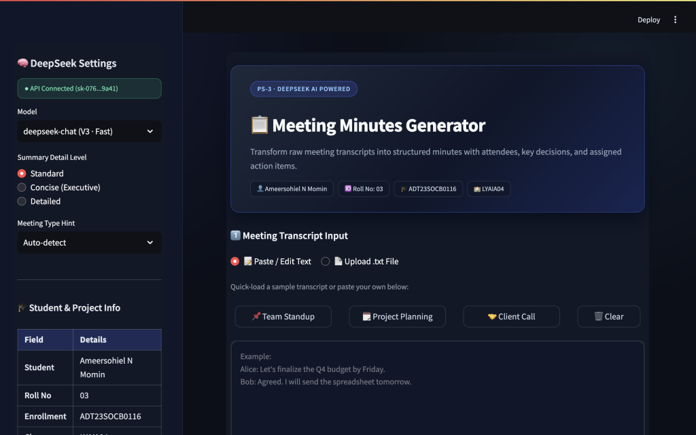
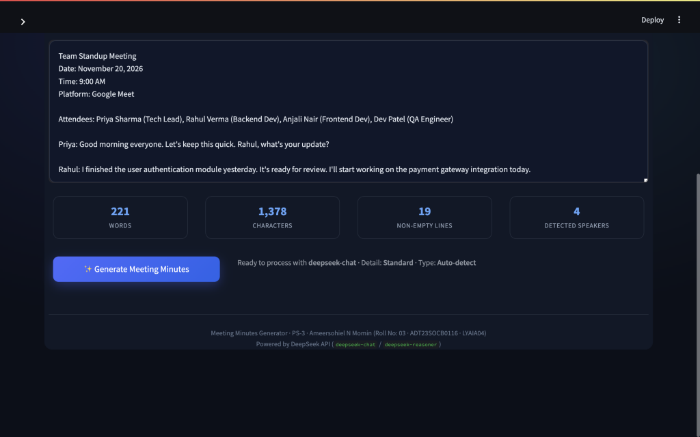
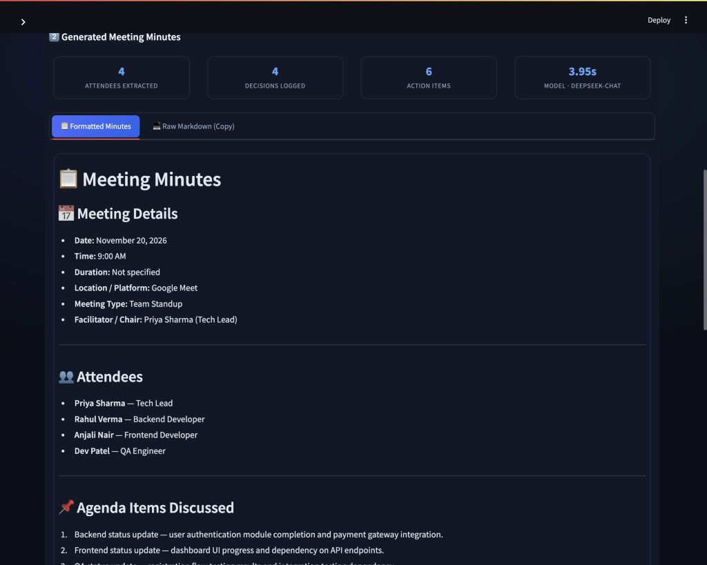
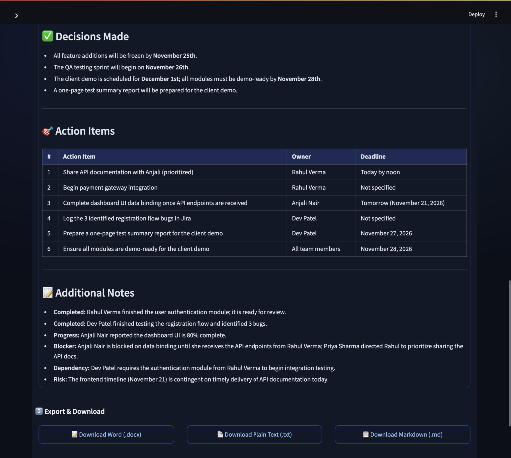

# 📋 Meeting Minutes Generator (PS-3)

> **GenAI Mini Project — Problem Statement 3** · Roll No: **03** · Enrollment: **ADT23SOCB0116** · Class: **LYAIA04**

An AI-powered **Streamlit** web application that converts raw meeting transcripts into structured, downloadable meeting minutes using the **DeepSeek API** (`deepseek-chat` / `deepseek-reasoner`).

---

## 🎯 Problem Statement

**Teams forget decisions made in meetings.** Raw transcripts are long and hard to scan for ownership and follow-ups. This tool transforms uploaded `.txt` transcripts or pasted text into clean, structured meeting minutes with:
- 📅 **Meeting Details** (Date, Time, Duration, Platform, Meeting Type, Chair)
- 👥 **Attendees** (Extracted names and roles)
- 📌 **Agenda Items Discussed** (Ordered summary)
- ✅ **Decisions Made** (Clear bulleted agreements)
- 🎯 **Action Items** (Table with Action Item, Owner, and Deadline)
- 📝 **Additional Notes** (Blockers, risks, and follow-ups)

---

## 📸 Application Screenshots

### 1. Main Interface & Sidebar Settings


### 2. Sample Input & Live Transcript Metrics


### 3. Generated Minutes & KPI Summary Cards


### 4. Action Items Table & Multi-Format Export


---

## 🛠️ Tech Stack

| Component | Technology |
|---|---|
| Language | Python 3.10+ |
| UI Framework | Streamlit (`1.41.1`) |
| LLM & SDK | DeepSeek API (`deepseek-chat`, `deepseek-reasoner`) via `openai` (`3.58.0`) |
| Word Export | `python-docx` (`1.1.2`) |
| Environment Config | `python-dotenv` (`1.0.1`) |

---

## 🚀 How to Run

### 1. Clone the repository
```bash
git clone https://github.com/AmeersohielMomin/Gen_AI_Assignment_3.git
cd Gen_AI_Assignment_3
```

### 2. Create a virtual environment (recommended)
```bash
python3 -m venv venv
source venv/bin/activate       # Mac / Linux
venv\Scripts\activate          # Windows
```

### 3. Install dependencies
```bash
pip install -r requirements.txt
```

### 4. Configure your API key
```bash
cp .env.example .env
# Edit .env and set your DeepSeek API key:
# DEEPSEEK_API_KEY=your_deepseek_api_key_here
```

### 5. Run the application
```bash
streamlit run app.py
```

Open `http://localhost:8501` in your browser.

---

## 📂 Repository Structure

```
Gen_AI_Assignment_3/
├── app.py                       # Streamlit UI (DeepSeek Slate & Indigo theme)
├── prompts.py                   # System prompt templates & detail customization
├── utils.py                     # DeepSeek client, transcript analytics & .docx/.txt export
├── requirements.txt             # Pinned Python dependencies
├── .env.example                 # Template for DEEPSEEK_API_KEY (never commit .env)
├── .gitignore                   # Excludes .env, venv/, __pycache__/
├── sample_transcripts/          # 5 sample transcripts for evaluation
│   ├── sample1_team_standup.txt
│   ├── sample2_project_planning.txt
│   ├── sample3_client_call.txt
│   ├── sample4_budget_review.txt
│   └── sample5_product_launch.txt
└── screenshots/                 # Application output screenshots
```

---

## ✨ Key Features

- **Dual Input Modes:** Switch cleanly between **Paste / Edit Text** (with one-click sample buttons) and **Upload `.txt` File**
- **Live Transcript Metrics:** Instant counts for words, characters, non-empty lines, and detected speakers
- **Configurable AI Controls:** Choose `deepseek-chat` (V3) or `deepseek-reasoner` (R1), summary detail level, and meeting type hint
- **Output Analytics & Views:** KPI cards for extracted attendees, decisions, action items, and latency + copy-ready Raw Markdown tab
- **Styled Document Exports:** Download as formatted **Word (`.docx`)** (with shaded header tables), **Plain Text (`.txt`)**, or **Markdown (`.md`)**

---

## 👤 Student Details

| Field | Value |
|---|---|
| Name | Ameersohiel N Momin |
| Roll No | 03 |
| Enrollment No | ADT23SOCB0116 |
| Class | LYAIA04 |
| Problem Statement | PS-3: Meeting Minutes Generator |
| Repository | https://github.com/AmeersohielMomin/Gen_AI_Assignment_3 |
